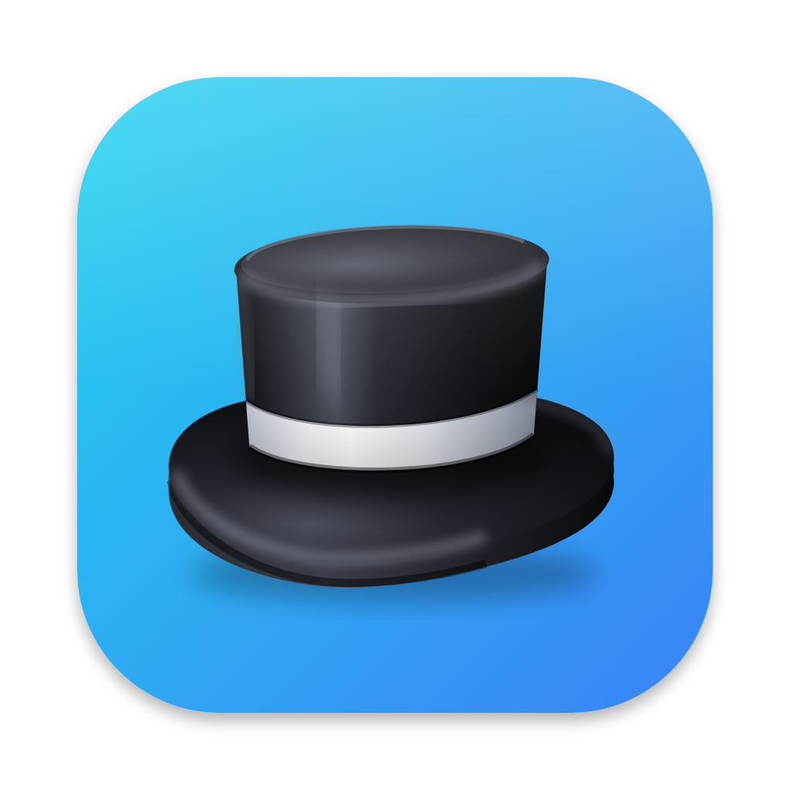
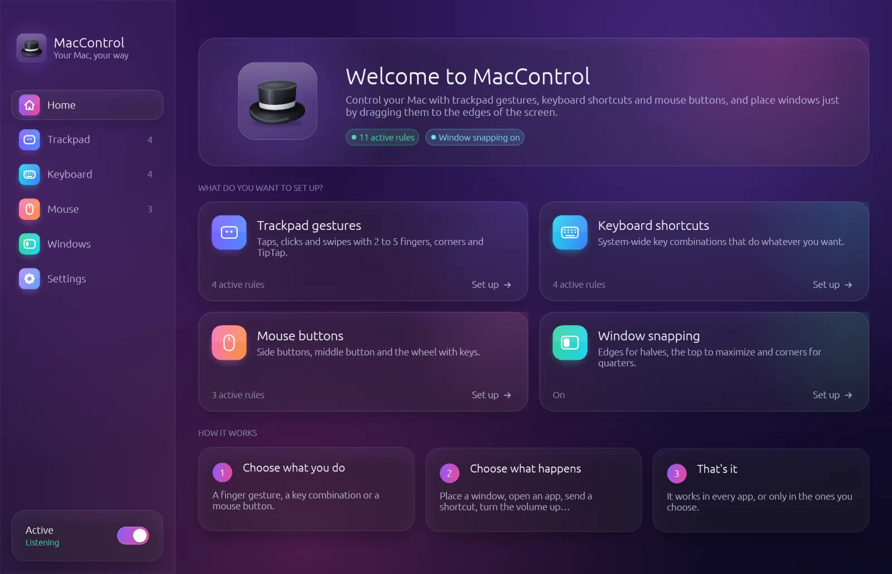
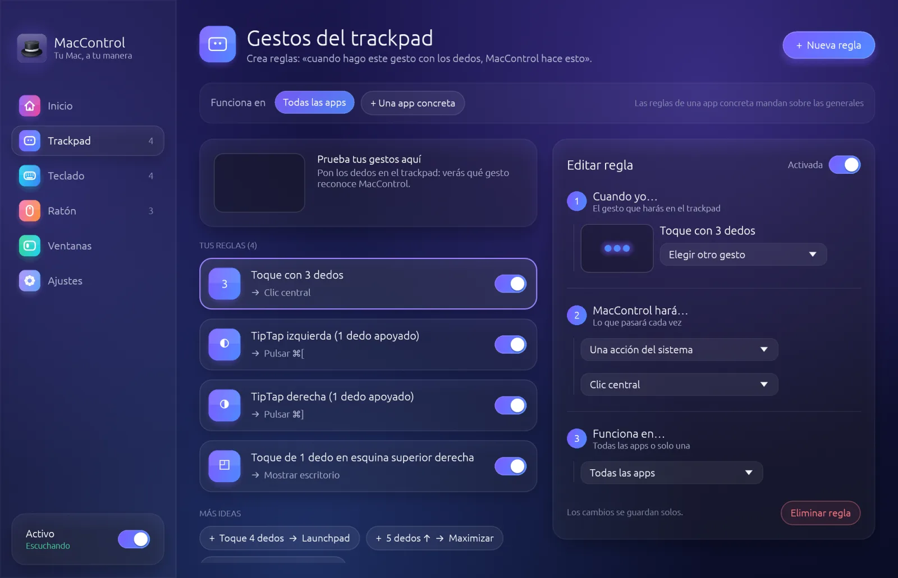
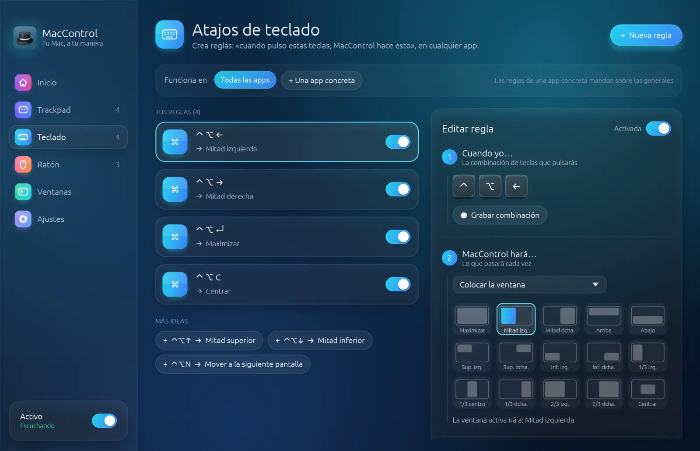
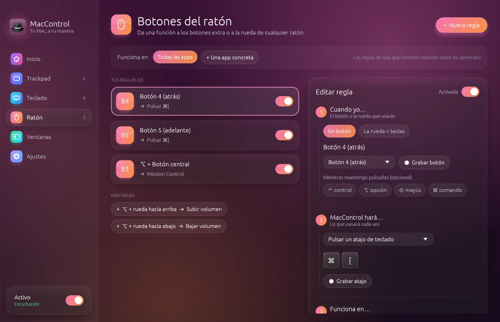
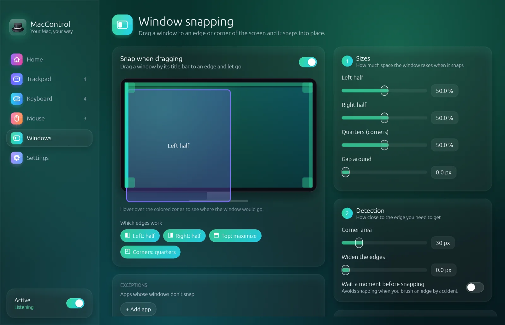

<p align="center">
  
</p>

<h1 align="center">MacControl</h1>

<p align="center">
  Trackpad gestures, keyboard shortcuts, mouse buttons and window snapping for macOS.<br />
  Give them new jobs, and snap windows into place by dragging them to the edges of the screen.
</p>

<p align="center">
  <a href="https://donbuche.github.io/maccontrol/"><strong>Website</strong></a> ·
  <a href="https://donbuche.github.io/maccontrol/es/">Español</a> ·
  <a href="https://donbuche.github.io/maccontrol/ca/">Català</a> ·
  <a href="https://github.com/donbuche/maccontrol/releases/latest"><strong>Download</strong></a>
</p>

<p align="center">
  
  
  
  
  
  
  <a href="LICENSE"></a>
</p>

<p align="center">
  
</p>

---

## Features

- **Trackpad gestures.** Taps, double taps and clicks with 2 to 5 fingers, 3, 4 and 5-finger swipes in four directions, one-finger taps in the corners, one-finger swipes in from the edge of the trackpad, and TipTap (rest one finger, tap with another to its left or right). A live tester shows which gesture MacControl recognises.
- **Keyboard shortcuts.** Global shortcuts recorded by just pressing them. The `fn` + arrow keys are shown as macOS really sends them (Home, Page Up, End, Page Down), with a warning that the key stops working everywhere while the rule is on.
- **Mouse buttons.** Side buttons, the middle button and the scroll wheel combined with modifier keys. Back and forward in the browser work out of the box.
- **Window snapping.** Drag a window to the left or right edge for a half, to the top to maximise it and to a corner for a quarter. A preview shows where it will land, sizes and margins are adjustable, and dragging a snapped window away gives it its old size back. Apps can be excluded.
- **Actions.** Place the window (halves, thirds, two thirds, quarters, maximise, centre), move it to the next display, restore its size, minimise the window under the cursor, Mission Control, App Exposé, show desktop, Launchpad, lock screen, screenshot, volume, left/right/middle click, send a keyboard shortcut, open an app or a URL, type text or run a shell command.
- **Per-app rules.** Every rule works in all apps or only in one; a rule made for an app wins over a general one.
- **Lives in the menu bar.** While its window is open MacControl has a Dock icon; closing the window (red button, ⌘W or ⌘Q) leaves it running from its top-hat icon in the menu bar. It only quits from that icon's menu. Rules can be paused from there too. ⌘, opens Settings.
- **In your language.** The interface is available in English, Spanish and Catalan. On first launch MacControl follows your Mac's language (English if it's none of the three), and you can switch it any time in **Settings → General**.

## Screenshots

| | |
|---|---|
|  |  |
| Trackpad gestures, with a live tester | Keyboard shortcuts |
|  |  |
| Mouse buttons and scroll wheel | Window snapping |

## Install

1. Download the `.dmg` from the [latest release](https://github.com/donbuche/maccontrol/releases/latest) and drag **MacControl** into **Applications**.
2. MacControl isn't notarised by Apple yet, so the first time macOS refuses to open it. Go to **System Settings → Privacy & Security** and click **Open Anyway**.
3. Allow MacControl in **Privacy & Security → Accessibility** (and **Input Monitoring** if macOS asks). It needs this to see shortcuts and mouse buttons in other apps and to move their windows.

Requires macOS 12 or later on a Mac with Apple silicon.

### Privacy

MacControl compares each key press, mouse button and gesture with your rules and lets everything else through. Nothing is sent anywhere. The settings live in `~/Library/Application Support/MacControl/config.json`, and a small diagnostic log in `~/Library/Logs/MacControl.log` notes only the shortcuts that matched a rule and what happened to the window they moved, never ordinary typing.

## Tech stack

| Area | Technology |
|---|---|
| Language | Rust (2024 edition) |
| UI | [egui](https://github.com/emilk/egui) / eframe, custom glass theme drawn by hand |
| Menu bar | [tray-icon](https://github.com/tauri-apps/tray-icon) with a template image |
| Keyboard and mouse | A Core Graphics event tap (`CGEventTapCreate`) that runs a rule and swallows the original event |
| Trackpad | The private MultitouchSupport framework, read through a callback, and a gesture recogniser in `src/gestures.rs` |
| Windows | The Accessibility API (`AXUIElement`) to find, move and resize other apps' windows |
| Dock and app menu | AppKit through [objc2](https://github.com/madsmtm/objc2) |
| Sound | [rodio](https://github.com/RustAudio/rodio) for the click sound |
| Storage | A JSON file written atomically |

## Building from source

You need Rust (stable) and the Xcode command line tools.

```bash
cargo run --release
```

### Scripts

| Command | Description |
|---|---|
| `./scripts/install-local.sh` | Build `MacControl.app`, replace the copy in `/Applications` and launch it |
| `./scripts/package-macos.sh` | Build `dist/MacControl.app` and `dist/MacControl-<version>.dmg` (`--no-dmg` for the app only) |
| `./scripts/setup-signing.sh` | Once per Mac: create a local code-signing certificate so macOS keeps the Accessibility permission across rebuilds |
| `./scripts/render-icons.sh` | Render `assets/icon.svg`, `assets/logo.svg` and `assets/tray.svg` into the PNGs the app embeds (needs Google Chrome) |
| `cargo test` | Run the tests (gesture recognition, snapping zones, rule lookup, translations, icons) |

Without the certificate from `setup-signing.sh`, every build gets a new ad-hoc signature and macOS asks for Accessibility again.

### Screenshots of the app

`maccontrol --screenshot <file.png> --page <home|trackpad|keyboard|mouse|snapping|settings>` opens the window with sample rules, saves a picture of it and quits. It doesn't read or change your settings. Set `MACCONTROL_LANG=en|es|ca` to pick the language, and add `--scale <n>` to draw it at `n` pixels per point (for example `--scale 1.8` for Retina-quality pictures on any display; the window can't be taller than the screen).

### Translations

Texts are written in English in the code and wrapped in `tl("…")` (or `tlf("…", &[…])` when they have `{}` placeholders). Their Spanish and Catalan versions live in the table in [`src/i18n.rs`](src/i18n.rs); a test fails if a text in the code is missing from it.

## Project structure

```
src/
  main.rs         Window setup and the embedded icons
  engine.rs       Shared state: config, recording, the last event, the front app
  model.rs        Rules, triggers, actions and settings (what is saved)
  i18n.rs         Interface languages, translations and the language picker
  gestures.rs     Trackpad gesture recogniser
  snap.rs         Snapping zones and target rectangles
  mechanics.rs    Tuning values for gestures and snapping
  sound.rs        Click sound
  mac/            macOS glue: event tap, multitouch, accessibility, actions, Dock
  ui/             egui pages, theme and icons
assets/           App icon, in-app logo and menu-bar icon (SVG sources and PNGs), sounds
scripts/          Packaging, installing, signing and icon rendering
site/             The landing page (see site/README.md)
docs/screenshots/ Screenshots used here and on the website
```

## Website

The landing page at <https://donbuche.github.io/maccontrol/> lives in [`site/`](site/). It's a static, multilingual page (English, Spanish and Catalan) built by a dependency-free Node script and deployed by GitHub Actions. See [`site/README.md`](site/README.md).

## Credits

- Click sound: "audio-volume-change" from the freedesktop.org sound theme, by Lucas McCallister (CC-BY-SA). See [`assets/sounds/CREDITS.txt`](assets/sounds/CREDITS.txt).
- Website fonts: Bricolage Grotesque, Figtree and JetBrains Mono (SIL Open Font License), self-hosted from [Fontsource](https://fontsource.org/).

Mac, macOS, Magic Trackpad and Mission Control are trademarks of Apple Inc. MacControl is an independent app and is not affiliated with or endorsed by Apple.

## License

[MIT](LICENSE) © Joan Galtés i Moreno · [Ariane webdesign](https://arianewebdesign.com).

The click sound keeps its own licence (CC-BY-SA) and the website fonts theirs (SIL Open Font License); see [Credits](#credits).
